# Ahmer Institute of Technology (AIT)

[](https://github.com/ahmershahdev/Ahmer-Institute-of-Technology/actions/workflows/ci.yml)
[](https://github.com/ahmershahdev/Ahmer-Institute-of-Technology/releases)
[](LICENSE.txt)


A university website and four connected portals, written in plain PHP and MySQL: a public site, an applicant and enrolled-student portal, a teacher portal, a staff portal, and an admin console with role-based sub-admins.

AIT is a portfolio project. The institute, its people, and its figures are fictional; the code, the security controls, and the tests are real.

> **Archived:** this repository is finished and read-only. v2.0.0 is the final release.
>
> **Status:** v2.0.0 adds a Docker stack, a rebuilt upload pipeline, SEO, Redis caching, and a 58-test end-to-end suite that found and fixed a dozen portal bugs. See the [changelog](CHANGELOG.md). v1.0.0 is still available under [releases](https://github.com/ahmershahdev/Ahmer-Institute-of-Technology/releases/tag/v1.0.0).

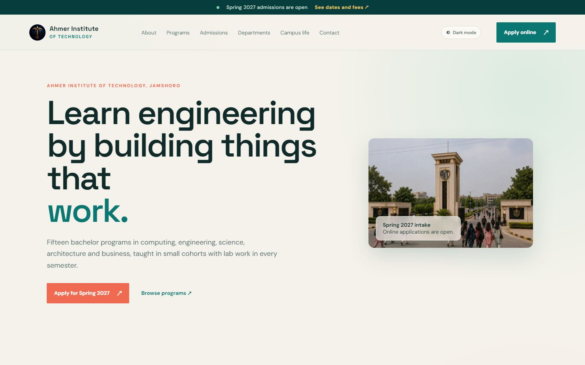

## Contents

- [What it does](#what-it-does)
- [Screenshots](#screenshots)
- [Quick start (Docker)](#quick-start-docker)
- [Running on XAMPP](#running-on-xampp)
- [Configuration](#configuration)
- [Architecture](#architecture)
- [Database](#database)
- [Security](#security)
- [SEO and performance](#seo-and-performance)
- [Testing](#testing)
- [Project layout](#project-layout)
- [Deployment](#deployment)
- [Documentation](#documentation)

## What it does

One admissions cycle, from first visit to first class:

1. **Applicant** registers, fills in the online form, ranks up to three programs, and uploads documents.
2. **Admissions reviewer** opens the application, views each document, and approves or rejects it with a note. Approval issues a student ID such as `26BSSE007` and a one-time temporary password, and enrols the student in their first-semester subjects.
3. **Student** signs in with that ID, is made to choose a private password, then sees subjects, timetable, attendance, marks, announcements, and fee challans.
4. **Teacher** takes attendance, enters marks, and posts announcements, but only for subjects the admin has assigned to them.
5. **Staff**: a Head of Department sees their department's teachers and subjects; other staff roles see only their own dashboard.
6. **Admin** controls semester fees and exam slips, verifies uploaded receipts, reviews attendance appeals, manages teachers, staff, subjects and the timetable, and edits public site copy.

| Portal | Entry point | Highlights |
| --- | --- | --- |
| Public site | `/` | 14 pages, programs catalogue, admissions guide with dates, merit formula and fees, FAQ, contact form |
| Applicant | `/registration`, `/login` | Online application, document upload, status timeline, fee challan, admit card |
| Enrolled student | `/student-login` | Subjects, timetable, attendance chart, marks, semester challans, appeals, issue reports |
| Teacher | `/teachers/login.php` | Attendance, marks, announcements, rosters, public profile at `/teachers/T00042` |
| Staff | `/staff/login.php` | HOD department overview; role-gated pages |
| Admin | `/admin/login.php` | Application review, sub-admins with nine granular permissions, teachers, staff, catalogue, timetable with clash detection, audit log |

## Screenshots

| | |
| --- | --- |
| 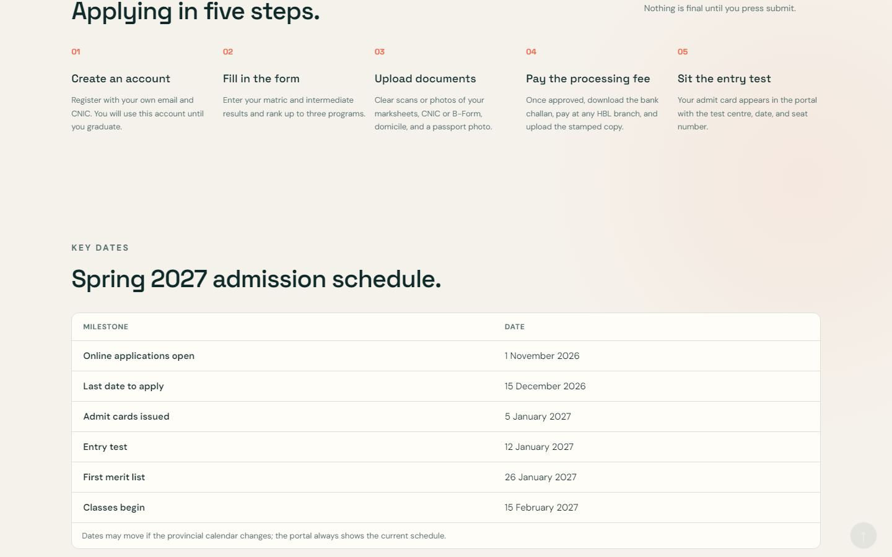 | 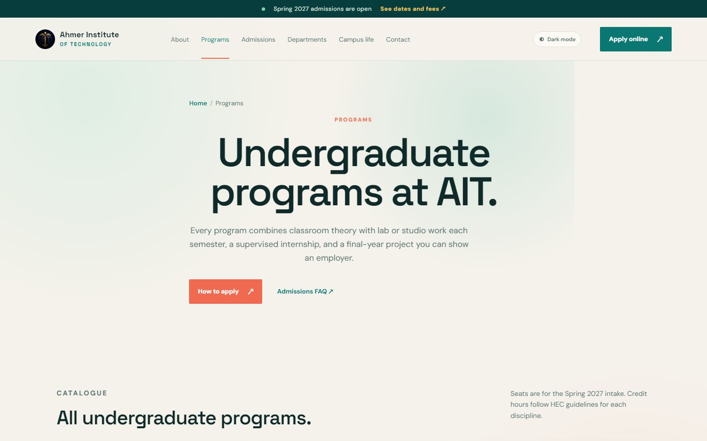 |
| **Admissions**: dates, eligibility, merit, fees | **Programs**: credit hours and seats per degree |
| 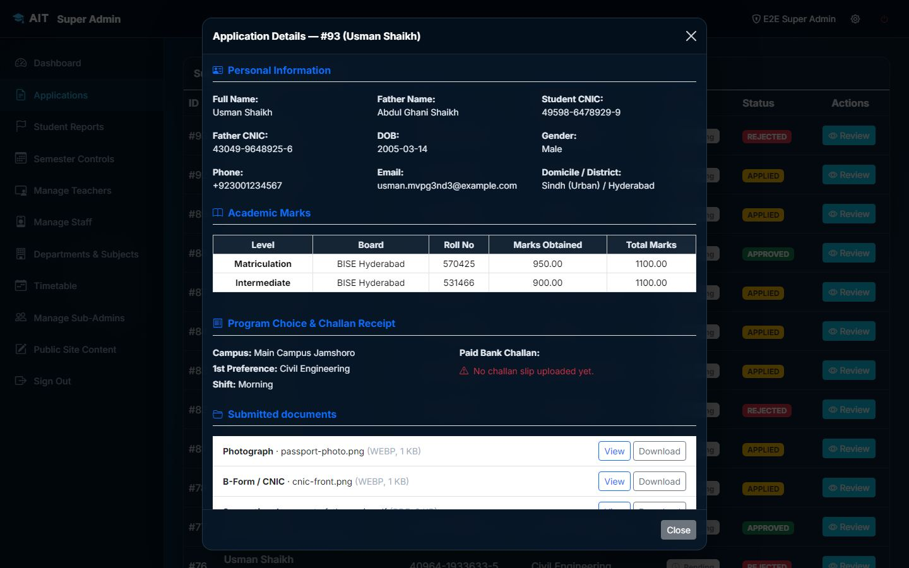 | 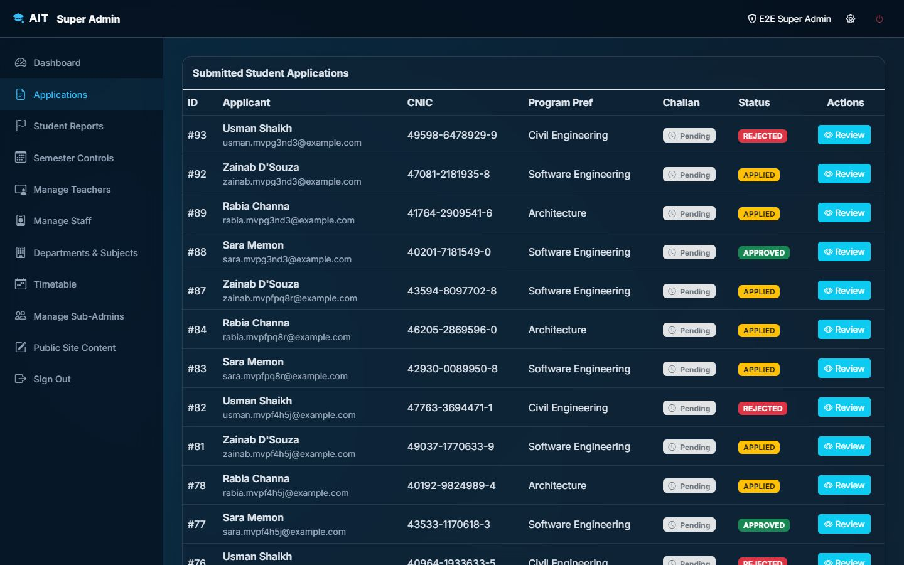 |
| **Admin review**: every document streams through an access-checked endpoint | **Applications** queue |
| 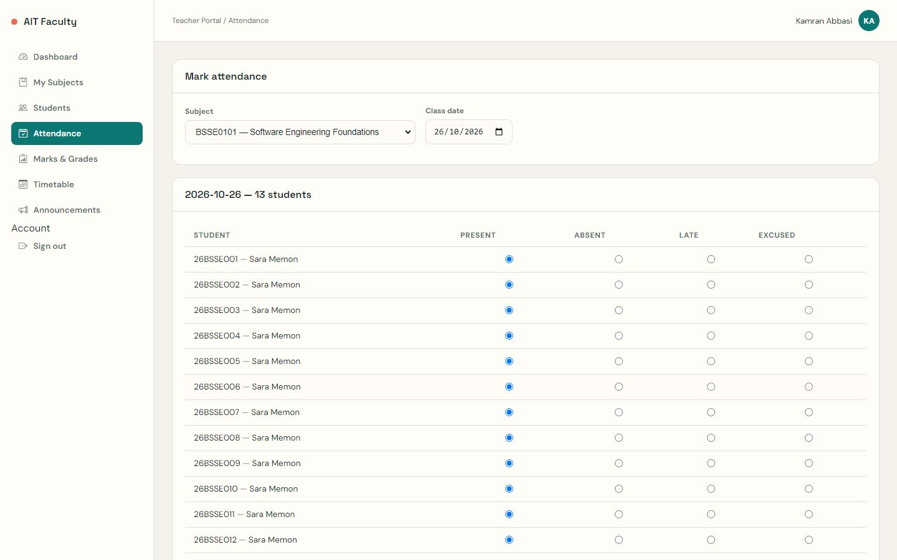 | 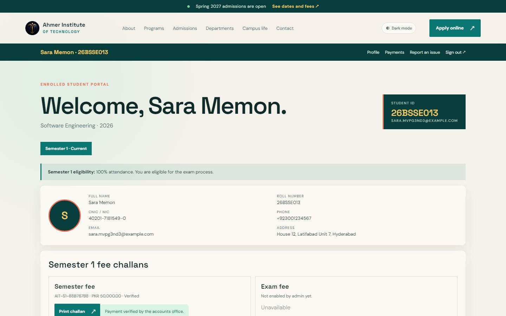 |
| **Teacher**: attendance for an assigned subject | **Student**: dashboard after admission |
| 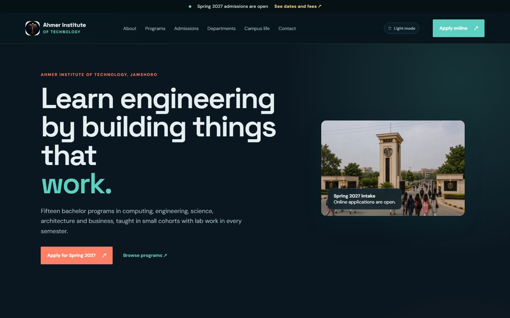 | 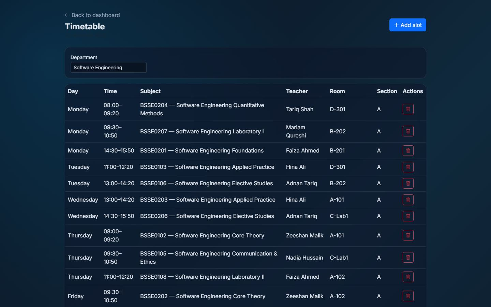 |
| **Dark mode** follows the system setting | **Timetable** with clash detection |

<p align="center">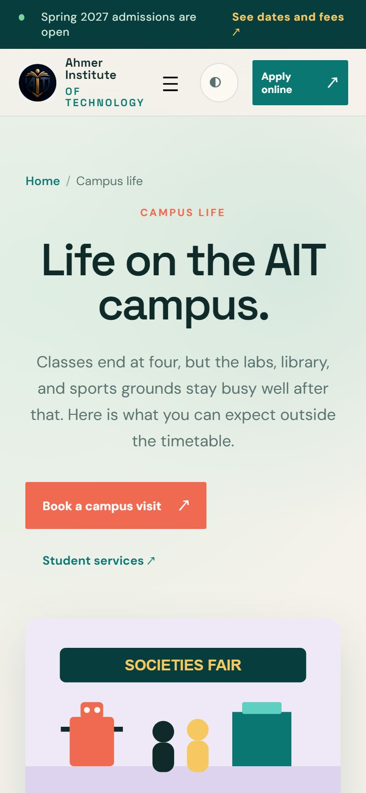</p>

## Quick start (Docker)

Requirements: Docker Desktop (or Docker Engine with Compose v2).

```bash
git clone https://github.com/ahmershahdev/Ahmer-Institute-of-Technology.git
cd Ahmer-Institute-of-Technology

sh bin/docker-init.sh                      # writes .env.docker with random secrets
docker compose up -d --build --wait        # web, MySQL 8, Redis 7, ClamAV

# create your own super-admin (the password is read from the environment or prompted)
docker compose exec -e AIT_ADMIN_PASSWORD='choose-a-strong-one' web \
  php bin/create-admin.php --email=you@example.com --name="Your Name"
```

Open <http://localhost:8080/AIT/>. Admin sign-in also asks for `SUPERADMIN_SECRET_KEY`, which `bin/docker-init.sh` wrote to `.env.docker`.

ClamAV downloads its signatures on first start, which takes two or three minutes. Uploads are refused until the scanner is ready, by design.

The published image is also available from GitHub Packages:

```bash
docker pull ghcr.io/ahmershahdev/ahmer-institute-of-technology:latest
```

## Running on XAMPP

1. Copy the project to `htdocs/AIT`.
2. Import `database/schema.sql` in phpMyAdmin (it creates the `ait` database and seed data).
3. Copy `.env.example` to `.env` and fill in the database credentials and a long `SUPERADMIN_SECRET_KEY`.
4. Create an admin: `php bin/create-admin.php --email=you@example.com`.
5. Open <http://localhost/AIT/>.

Without Redis, the cache falls back to APCu or per-request memory and sessions use files. Without ClamAV, set `UPLOAD_AV_REQUIRED=0` to allow uploads (they are still type-checked and re-encoded).

## Configuration

All configuration comes from environment variables (`.env` on XAMPP, `.env.docker` in Docker). Nothing secret lives in the source.

| Variable | Purpose |
| --- | --- |
| `DB_HOST`, `DB_NAME`, `DB_USER`, `DB_PASS` | MySQL connection |
| `SUPERADMIN_SECRET_KEY` | Second factor for super-admin sign-in and password recovery |
| `APP_URL`, `APP_BASE_PATH` | Canonical URL used in sitemaps, canonical tags and structured data |
| `REDIS_HOST`, `REDIS_PORT`, `REDIS_PASSWORD` | Sessions, rate limits, cache (optional) |
| `CLAMAV_HOST`, `CLAMAV_PORT`, `UPLOAD_AV_REQUIRED` | Antivirus scanning of uploads |
| `UPLOAD_ROOT`, `UPLOAD_CDR_REQUIRED` | Upload storage (keep it outside the web root) and PDF rebuilding |
| `RECAPTCHA_V2_*`, `RECAPTCHA_V3_*` | Optional; a built-in challenge is used when empty |
| `CONTACT_EMAIL`, `CONTACT_PHONE`, `CONTACT_*` | Institute contact details shown on the site |
| `RATE_LIMIT_MULTIPLIER`, `PAGE_CACHE` | Load-testing and cache switches |

## Architecture


- **Routing**: `.htaccess` maps clean URLs (`/admissions`, `/dashboard`) to role folders and canonicalises `/home` and `.php` URLs with 301 redirects.
- **Public site**: one page registry in `backend/site.php` drives titles, descriptions, canonical URLs, Open Graph tags, breadcrumbs, JSON-LD, the sitemap and the section renderer, so they cannot drift apart.
- **Portals**: each role has its own folder and session keys; shared services live in `backend/`.
- **Data**: MySQL 8 with foreign keys, unique constraints, and `SELECT ... FOR UPDATE` around every state change that two people could race.

Source for the diagram: [`docs/diagrams/architecture.mmd`](docs/diagrams/architecture.mmd).

## Database

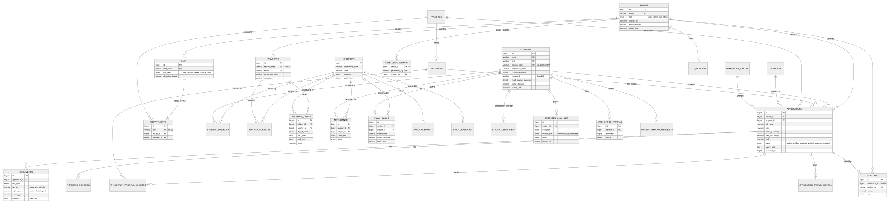

30 tables and 2 reporting views. The full schema, constraints, indexes and seed data are in [`database/schema.sql`](database/schema.sql); the diagram source is [`docs/diagrams/erd.mmd`](docs/diagrams/erd.mmd).

Key rules enforced by the database itself:

- one application per student per cycle, and one challan per application (`UNIQUE`)
- unique student IDs, teacher and staff codes, emails and CNICs
- timetable `CHECK` constraints on days and times, plus clash detection in the app
- cascading deletes for enrolment, attendance and marks; `SET NULL` for authorship

## Security

| Area | What is in place |
| --- | --- |
| Passwords | Argon2id (bcrypt cost 12 fallback), rehash on login, policy: 10+ characters with mixed case and a digit, no common or personal words |
| Sign-in | Per-account lockout after 5 failures, captcha after 3, constant-time lookups for unknown accounts, session regeneration, forced change of temporary passwords |
| Sessions | Redis-backed, `HttpOnly`, `SameSite=Strict`, `Secure` on HTTPS, idle and absolute timeouts, fingerprint check |
| CSRF | 256-bit per-session token on every form, plus a `Sec-Fetch-Site` check that rejects cross-site posts |
| XSS | Output escaping everywhere, strict nonce-based CSP with `script-src-attr 'none'`, DOM APIs instead of `innerHTML` for data |
| Headers | CSP, `X-Frame-Options: DENY`, `nosniff`, `Referrer-Policy`, `Permissions-Policy`, COOP/CORP, HSTS on HTTPS |
| Rate limits | Atomic Redis counters per account and per IP on every form; `429` with `Retry-After` |
| Bots | Honeypot field, HMAC-signed render time, arithmetic challenge or reCAPTCHA v2/v3 |
| Authorisation | Role checks on every request, nine sub-admin permissions, ownership checks on every file, teachers limited to their own subjects |
| Concurrency | Row locks for applications, approvals, receipts, appeals and subject assignment; IDs derived from primary keys |
| Exposure | `.env`, `.git`, SQL, docs, tooling and `backend/` are never served; directory listing off |

### File uploads

Every uploaded file goes through `backend/uploads.php`:

1. **Allow-list**: JPG, PNG, WebP and PDF only.
2. **Magic bytes**: the file signature must match both the extension and `finfo`'s MIME type, so `shell.php` renamed to `photo.jpg` is rejected.
3. **Size limits**: 5 MB for images, 10 MB for PDFs; images between 32 and 10,000 pixels a side.
4. **Antivirus**: streamed to ClamAV (`clamd` INSTREAM). If the scanner is required and down, uploads are refused rather than waved through.
5. **Content disarm and reconstruction**: images are decoded and re-encoded to WebP, which drops metadata and anything appended to the file; PDFs are rebuilt with Ghostscript, and PDFs containing JavaScript, launch actions, attachments, forms or encryption are rejected.
6. **Rename**: stored under a random 128-bit name. The original name is sanitised and kept only for display.
7. **Storage**: `UPLOAD_ROOT`, outside the web root. A fallback `uploads/.htaccess` denies everything and disables script execution.
8. **Access**: files are only ever served by `download_file.php`, after checking that the requester owns the file or is an admin with the right permission. Responses carry `Content-Disposition: attachment`, `nosniff`, `no-store` and a sandbox CSP.

Report vulnerabilities as described in [SECURITY.md](SECURITY.md).

## SEO and performance

- Titles under 60 characters and descriptions under 150 on every public page, checked by the test suite.
- Canonical URLs, `hreflang`, Open Graph and Twitter cards with a 1200×630 image.
- JSON-LD: `CollegeOrUniversity`, `WebSite`, `WebPage`, `BreadcrumbList`, `FAQPage` and an `ItemList` of programs.
- One `h1` per page, no skipped heading levels, alt text on every image, visible breadcrumbs.
- Dynamic [`sitemap.xml`](https://ait.ahmershah.dev/sitemap.xml) and `robots.txt`, plus [`llms.txt`](llms.txt) and [`llms-full.txt`](llms-full.txt) for AI agents.
- Caching layers: OPcache with JIT, Redis (sessions, rate limits, data), APCu as a hot local layer, a Redis full-page cache for anonymous visitors, and year-long immutable caching for fingerprinted assets.
- Brotli compression with gzip fallback; responsive WebP images with `srcset`, lazy loading and explicit dimensions.

## Testing

```bash
docker compose exec web php tests/php/run.php     # 23 backend tests

cd tests/e2e
npm install && npx playwright install chromium
npx playwright test                                # 58 end-to-end tests
npx playwright show-report
```

The end-to-end suite plays one admissions cycle with fourteen personas:

| Persona | Role | What they do |
| --- | --- | --- |
| Ayesha | Visitor | Reads all 14 public pages; SEO, headers, sitemap, redirects, mobile nav |
| Bilal | Parent | Uses the contact form; a bot-speed post and a filled honeypot are refused |
| Hamza | Applicant | Makes every registration mistake, then gets locked out after five wrong passwords |
| Sara | Applicant → student | Applies, is admitted, sets her own password, sees classes, marks and announcements |
| Rabia | Applicant | Fires three parallel submissions; exactly one application is stored |
| Zainab | Applicant | Uploads a disguised PHP script and a PDF with JavaScript; both are rejected |
| Usman | Applicant | Is rejected and sees the reviewer's reason |
| Imran | Super admin | Reviews documents, approves Sara, schedules classes, verifies her fee receipt |
| Nadia | Sub-admin (teachers) | Creates teacher Kamran and assigns his subjects; locked out of staff pages |
| Omar | Sub-admin (admissions) | Rejects Usman; locked out of teacher, staff, catalogue and timetable pages |
| Kamran | Teacher | Replaces his temporary password, takes attendance, enters marks, posts announcements |
| Farah | Head of Department | Sees her department, including Kamran |
| Ali | Security staff | Has no access to the department overview |
| Eve | Attacker | Tries IDOR, path traversal, CSRF, SQL injection, stored XSS, brute force and file exposure |

What "coverage" means here: every public route, every portal page, and every state-changing action in all four portals is exercised by at least one test, and the CSP-violation sweep loads every portal page. Line-level code coverage is not instrumented.

CI runs the same two suites against the Docker stack on every push and pull request.

## Project layout

| Path | Contents |
| --- | --- |
| `pages/` | Public page entry points (rendered by `backend/site.php`), `sitemap.php`, `robots.php` |
| `student/` | Applicant and enrolled-student pages, uploads, challans, slips, the download endpoint |
| `admin/` | Admin console, teachers, staff, catalogue, timetable |
| `teachers/`, `staff/` | Teacher and staff portals |
| `backend/` | Security, uploads, sessions, cache, database, RBAC, public site |
| `database/schema.sql` | Schema, constraints, views, seed data |
| `docker/`, `docker-compose.yml` | Container image and local stack |
| `bin/` | `docker-init.sh`, `create-admin.php` |
| `tests/php/`, `tests/e2e/` | Backend and Playwright suites; `tests/e2e/tools/docs-assets.cjs` regenerates the README images |
| `docs/` | Diagrams and screenshots |

## Deployment

- Serve over HTTPS and set `APP_URL` to the public origin. On a dedicated host, change `/AIT/` to `/` in `.htaccess` and set `APP_BASE_PATH=/`.
- Point `UPLOAD_ROOT` at a directory outside the document root and keep `UPLOAD_AV_REQUIRED=1`.
- Use a least-privilege MySQL user, a long `SUPERADMIN_SECRET_KEY`, and a password on Redis.
- Pushing a tag such as `v2.0.1` builds the image and publishes it to GitHub Packages with a release.

## Documentation

- [Wiki](https://github.com/ahmershahdev/Ahmer-Institute-of-Technology/wiki): user guides for each portal, operations, and troubleshooting
- [CHANGELOG.md](CHANGELOG.md)
- [SECURITY.md](SECURITY.md)
- [llms.txt](llms.txt) and [llms-full.txt](llms-full.txt)
- [LICENSE.txt](LICENSE.txt): MIT

Built by [Syed Ahmer Shah](https://ahmershah.dev/).
